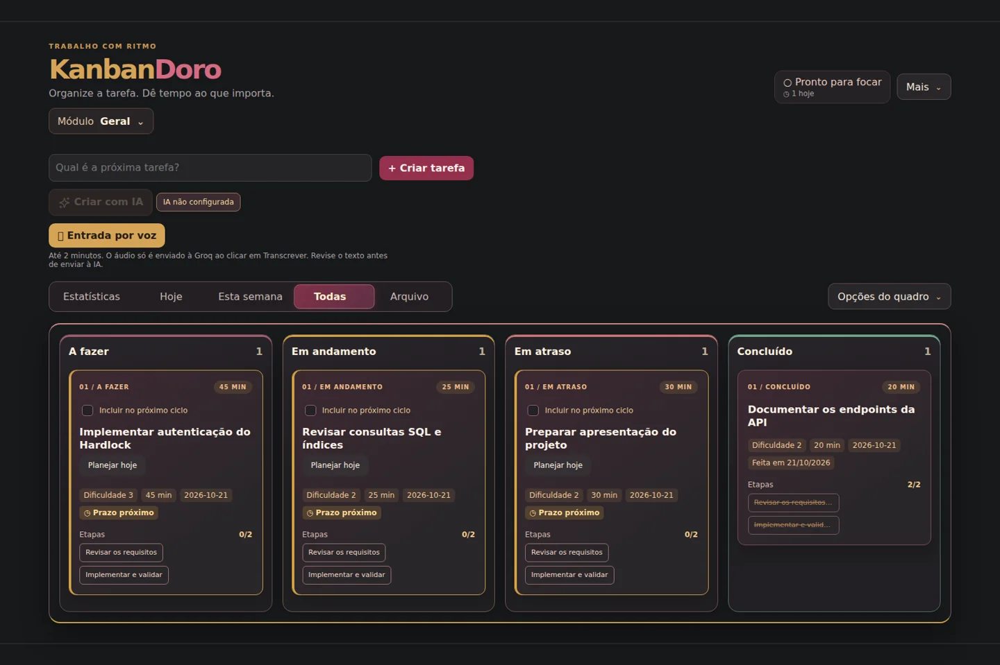
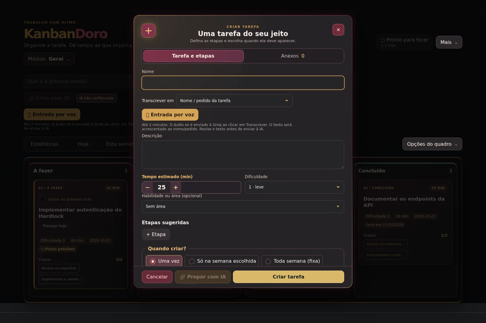
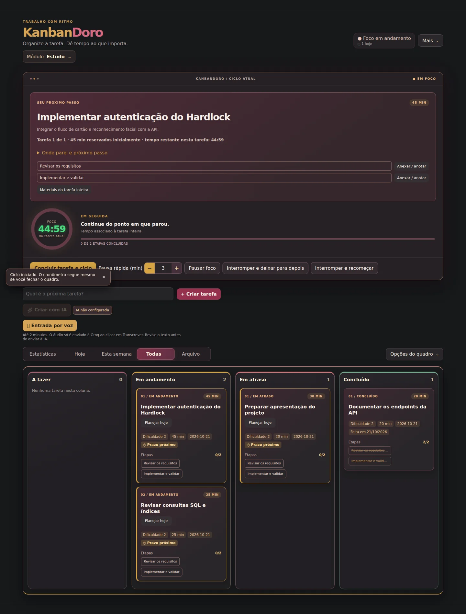

  
  <h1>KanbanDoro</h1>
  
<strong>Organize a tarefa. Dê tempo ao que importa.</strong>

  
Kanban, ciclos de foco e assistência de IA em uma extensão para o navegador.

  

    <a href="https://github.com/JanGustavo/KanbanDoro/releases">Baixar extensão</a> ·
    <a href="#comece-por-aqui">Como instalar</a> ·
    <a href="./docs/GUIA-DE-USO.md">Guia de uso</a> ·
    <a href="./docs/DESENVOLVIMENTO.md">Desenvolvimento</a>
  

> Capturas com tarefas de exemplo, geradas a partir da interface da versão 1.0.0 em uma execução com APIs do Chrome simuladas. As imagens não demonstram conexões com contas ou chamadas reais de IA.

## Por que usar?

Transforme uma tarefa grande em etapas menores, escolha o próximo passo e reserve um tempo para executá-lo. Ao terminar, acompanhe o foco registrado e decida o que ajustar no próximo ciclo.

| Para…              | Você pode…                                                                             |
| ------------------ | -------------------------------------------------------------------------------------- |
| Organizar o dia    | Distribuir tarefas no Kanban e montar um plano em ordem de execução.                   |
| Manter o foco      | Iniciar ciclos por tarefa ou por etapas, com pausas e bloqueio opcional de distrações. |
| Retomar o trabalho | Guardar onde parou, o próximo passo, anotações e arquivos.                             |
| Estudar            | Separar matérias e tópicos, definir uma meta diária e acompanhar revisões.             |
| Planejar com IA    | Revisar propostas de tarefas e etapas antes de aceitar a criação.                      |
| Entender seu ritmo | Consultar tempo de foco, conclusões e revisão semanal.                                 |

## Comece por aqui

### 1. Instale a extensão

1. Abra as [Releases](https://github.com/JanGustavo/KanbanDoro/releases) e baixe o ZIP da extensão na versão desejada.
2. Extraia o ZIP em uma pasta que você pretende manter no computador.
3. Abra `chrome://extensions` ou `brave://extensions` e ative o **Modo do desenvolvedor**.
4. Clique em **Carregar sem compactação** e escolha a pasta que contém o `manifest.json`.
5. Clique no ícone do KanbanDoro para abrir seu quadro.

Prefere compilar? Veja [instalação a partir do código](./docs/GUIA-DE-USO.md#instalar-a-partir-do-código).

### 2. Crie sua primeira tarefa

Clique em **+ Criar tarefa**, dê um nome e defina uma estimativa. Se fizer sentido, adicione etapas, área, prazo ou recorrência. Você pode começar com uma tarefa simples e ajustar depois.

Ver a tela de criação

### 3. Escolha o próximo passo e foque

Use **Planejar hoje** no card para montar seu plano. Abra uma tarefa para iniciar um ciclo individual ou selecione várias para montar um ciclo em sequência.

Ao terminar o tempo reservado, escolha como continuar. O descanso e a retomada dependem da sua confirmação. Consulte as [regras dos ciclos e pausas](./docs/GUIA-DE-USO.md#produto).

### 4. Revise e guarde seu progresso

Abra **Estatísticas** para acompanhar o tempo registrado e revisar a semana. Em **Preferências → Dados**, use **Exportar ZIP completo** para guardar também os arquivos anexados. O backup JSON inclui os dados textuais, mas não os arquivos binários.

## IA e conexões são opcionais

O quadro e os ciclos funcionam com dados locais, sem configurar IA ou conectar uma conta Google.

- **IA:** configure Groq, Gemini ou OpenAI em **Mais → Preferências → IA**. As propostas passam pela sua revisão; a disponibilidade e os custos dependem do provedor. [Configurar IA →](./docs/IA.md)
- **Voz:** grave e revise uma transcrição antes de usar o texto. A transcrição utiliza a Groq e exige a chave desse provedor. [Como funciona →](./docs/GUIA-DE-USO.md#entrada-por-voz)
- **Connections:** consulte Gmail, Calendar e Tasks e revise as ações antes de confirmar. Exige backend e OAuth configurados; não há sincronização automática do quadro. [Configurar Connections →](./docs/CONNECTIONS.md)

As tarefas ficam no armazenamento local da extensão; os arquivos anexados ficam no IndexedDB do perfil. Chaves de IA e credenciais Google não entram nos backups do quadro. Veja os [limites de backup e restauração](./docs/GUIA-DE-USO.md#backup-e-restauração) antes de trocar de perfil ou remover a extensão.

## Quer se aprofundar?

| Documento                                           | O que você encontra                                                    |
| --------------------------------------------------- | ---------------------------------------------------------------------- |
| [Guia de uso](./docs/GUIA-DE-USO.md)                | Planejamento, tarefas, ciclos, pausas, lembretes, materiais e backup.  |
| [IA](./docs/IA.md)                                  | Chaves, modelos, propostas, fontes e informações enviadas ao provedor. |
| [Connections](./docs/CONNECTIONS.md)                | Integrações Google, permissões, OAuth e configuração local.            |
| [Desenvolvimento](./docs/DESENVOLVIMENTO.md)        | Arquitetura, validação, API e publicação de versões.                   |
| [Modo estudo e perfis](./docs/WORKFLOW_PROFILES.md) | Metas, matérias, tópicos e revisões.                                   |
| [Backend](./backend/README.md)                      | Serviço FastAPI, banco e implantação.                                  |
| [Requisitos](./docs/REQUISITOS.md)                  | Regras do produto e decisões em aberto.                                |

Para contribuir, execute `npm ci` e `npm run validate`. O projeto usa React, TypeScript e Vite na extensão Manifest V3, com backend FastAPI. Tarefas e sessões do quadro ainda não são sincronizadas com a API.
